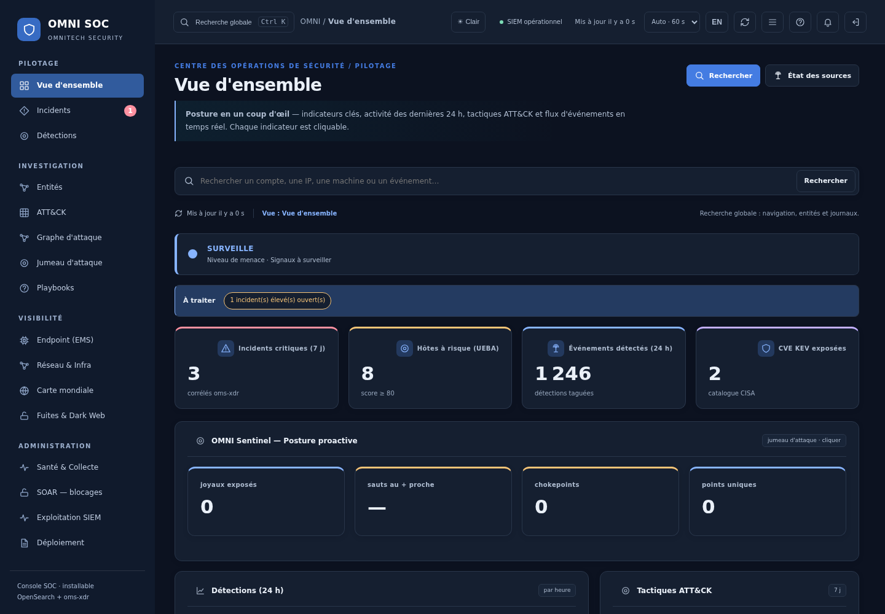
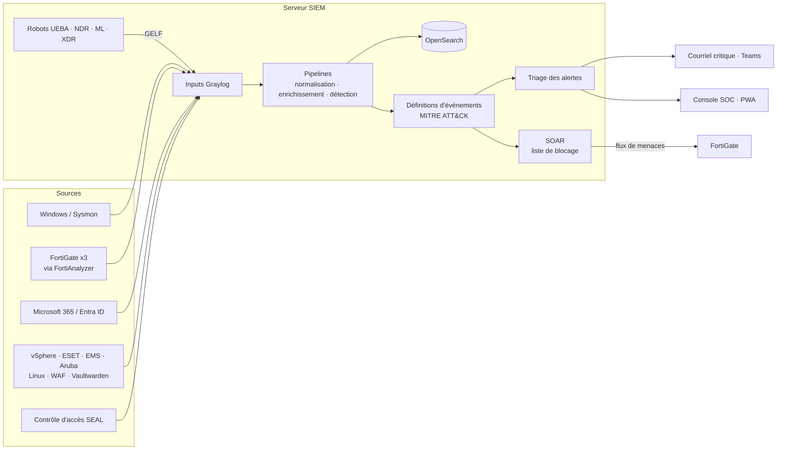

<div align="center">



<small>Console SOC actuelle, avec des données synthétiques de démonstration.</small>

# OMNI SIEM

**Plateforme SIEM et console SOC auto-hébergées, construites sur Graylog,
OpenSearch et MongoDB, pour la détection et la réponse aux incidents
d'OMNITECH SECURITY.**


[English version](README.md) · [Documentation](docs/README.md) · [Feuille de route](docs/ROADMAP.md) · [Journal des modifications](CHANGELOG.md)

</div>

> **Dépôt d'infrastructure interne.** Ce dépôt provisionne et maintient le SIEM
> de production d'OMNITECH SECURITY. Il se traite comme du code d'infrastructure
> sensible : aucun secret n'y est versionné (voir [SECURITY.md](SECURITY.md)).

## Présentation

La [distribution complète en préversion](docs/DISTRIBUTION.md) comprend une
archive du dépôt, des paquets `.deb`/`.rpm` et la commande `omni-siem` pour
configurer, installer le socle, gérer les modules et examiner les mises à jour
depuis SSH. Tous les composants sont livrés ; les extensions demandant des comptes
ou un paramétrage propre au site restent à activer explicitement. Les paquets ne
modifient pas une installation existante à leur installation/mise à jour.
Le serveur natif cible Ubuntu/Debian ; Ubuntu 26.04 reste expérimental et le RPM
ne qualifie pas le serveur sur RHEL/Rocky/Fedora. Voir les
[commandes ligne par ligne, limites et procédures de reprise](docs/DISTRIBUTION.md).
Le parcours `omni-siem adopt` détecte aussi une copie installée sous `/home` ou un
autre chemin et propose sa remise en place, avec plan, sauvegarde et retour arrière
pour les références reconnues ; les données des bases restent sur leur stockage.

OMNI SIEM centralise les journaux du système d'information (postes et
serveurs Windows, pare-feu Fortinet de trois sites, Microsoft 365 et Entra ID,
virtualisation, antivirus, WAF, Linux, commutateurs, contrôle d'accès
physique), les normalise dans un schéma de champs commun, applique des
détections rattachées à MITRE ATT&CK et ajoute des services maison :

- **triage des alertes** : score multi-critères, regroupement, et appel à une
  API LLM externe pour les seuls cas ambigus (couche hors service au
  21/11/2026, voir les limites) ; seul le critique part par courriel ;
- **corrélation d'incidents** (`oms-xdr`), **détection d'anomalies** (`oms-ml`)
  et **graphe d'exposition** (`oms-graph`) ;
- **réponse automatisée** limitée et réversible : blocage d'IP sur les
  FortiGate par flux de menaces, durée limitée, exclusions, mode simulation ;
- **console SOC** web et application installable (PWA) ;
- **production de preuves ISO/IEC 27001:2022** : rétentions, chaîne
  d'intégrité, dossiers de preuves mensuels.

## Capacités en service

Relevé effectué le 21/11/2026 en lecture seule sur l'installation de
référence (API Graylog, systemd). Ces chiffres décrivent cette installation ;
une installation neuve n'en déploie que le socle.

| Élément | Valeur |
|---|---|
| Inputs Graylog | 14 |
| Streams | 21 |
| Pipelines / règles de pipeline | 40 / 277 |
| Définitions de détection et de corrélation | 210, dont 199 actives (hors définition système de Graylog) |
| Tableaux de bord Graylog | 13 |
| Tables de correspondance | 34 |
| Minuteries systemd des robots (`omni-*`, `oms-*`) | 51 |
| Techniques ATT&CK distinctes dans la table de correspondance | 77, sur 12 tactiques |
| Fiches d'aide à la décision par type d'alerte | 150 (`lookups/alert-guidance.json`) |

Sources disposant d'un input ou d'un stream dédié : Windows Security,
Sysmon et autres journaux Windows (Winlogbeat TLS), FortiGate des trois sites
via FortiAnalyzer, FortiManager, FortiClient EMS, DHCP FortiGate,
Microsoft 365 et Entra ID, vSphere, ESET PROTECT, BunkerWeb, Vaultwarden,
Linux, commutateurs Aruba, contrôle d'accès SEAL (accès, alarmes, audit).

Le nombre de définitions mesure l'étendue du catalogue, pas l'efficacité de
détection : la validation par scénarios reste à outiller (voir
[Statut et limites](#statut-et-limites)).

## Architecture

Tout fonctionne sur **un seul serveur physique** Debian 13 (le nom
`bx-it-graylog-vm` est historique), avec les données OpenSearch chiffrées au
repos (LUKS2, déverrouillage TPM2). Les services internes écoutent sur
l'interface locale ; seuls nginx (HTTPS) et les inputs de collecte sont
exposés, filtrés par nftables.



Détails : [architecture](docs/architecture/ARCHITECTURE.md),
[dossier d'architecture](docs/architecture/DOSSIER-ARCHITECTURE-SIEM.md),
[sources](docs/DATA-SOURCES.md), [détections](docs/detection/DETECTIONS.md),
[alerting et triage](docs/ALERTING-AND-TRIAGE.md).

## Prérequis

- Ubuntu Server 24.04 ou 22.04, ou Debian 12 ou 13, amd64, avec systemd ;
  Ubuntu 26.04 est expérimental (voir la [qualification](docs/QUALIFICATION-UBUNTU2604.md)).
- Processeur avec AVX, au moins 16 Go de mémoire, stockage dimensionné pour le
  volume de journaux.
- Accès root, nom DNS et FQDN corrects, accès aux dépôts des éditeurs.

Le chiffrement LUKS/TPM de l'installation de référence est une opération
distincte : l'installateur ne le crée pas. Le détail figure dans
[INSTALLATION.md](docs/INSTALLATION.md).

## Démarrage rapide

Installation d'une machine neuve (plan en lecture seule, puis application) :

```bash
git clone https://github.com/jmorin-info/omnitech-siem-setup.git
cd omnitech-siem-setup
cp 00-vars.env.example 00-vars.env && chmod 600 00-vars.env
$EDITOR 00-vars.env                      # renseigner le site
sudo bash install.sh --generate-secrets
sudo bash install.sh --plan
sudo bash install.sh --apply
```

Le profil installé comprend MongoDB, OpenSearch, Graylog, les inputs et
pipelines de base, les détections initiales, le tableau de bord SOC, nginx, la
console `/soc/` et une sauvegarde quotidienne. Les extensions (robots,
XDR/ML, SOAR, connecteurs nécessitant des identifiants) s'activent ensuite,
chacune selon sa procédure.

Une interface d'administration en terminal regroupe ces opérations :
`sudo python3 tools/omni-manager.py`
([guide](docs/INTERFACE-ADMINISTRATION.md)). Pour une instance existante,
suivre la procédure de [mise à jour du code](docs/UPDATES.md).

**Ne jamais exécuter les scripts numérotés en boucle** : certains purgent des
journaux ou modifient des rétentions. Leur rôle et leur statut sont recensés
dans [SCRIPTS-PROVISIONING.md](docs/reference/SCRIPTS-PROVISIONING.md).

## Documentation

L'[index de la documentation](docs/README.md) présente les documents par
parcours : découvrir, installer, exploiter au quotidien, réagir à un
incident, mettre à jour, conformité ISO 27001, référence. Points d'entrée
fréquents :

- [Guide d'exploitation de l'installation de référence](docs/exploitation/GUIDE-EXPLOITATION.md)
  (configuration, enrôlement des hôtes, sauvegardes, dépannage, supervision) ;
- [Aperçu visuel](docs/demarrage/APERCU-VISUEL.md) et [utilisation de la console SOC](docs/CONSOLE-SOC.md) ;
- [Procédure de gestion des incidents](docs/exploitation/PROCEDURE-INCIDENT.md) ;
- [Restauration](docs/exploitation/RESTORE.md) et [plan de reconstruction](docs/exploitation/PRA-RECONSTRUCTION-SIEM.md).

## Organisation du dépôt

| Chemin | Contenu |
|---|---|
| `NN-*.sh` | Scripts de provisioning numérotés ([inventaire](docs/reference/SCRIPTS-PROVISIONING.md)) |
| `install.sh`, `tools/` | Installateur, gestionnaire SSH, mise à jour, outils ; `tools/ponctuel/` : scripts datés à usage unique |
| `lib-graylog.sh`, `lib-platform.sh` | Fonctions communes (API Graylog, plateforme) |
| `triage/`, `soar-v2/` | Triage des alertes, SOAR |
| `oms-xdr/`, `oms-ml/`, `oms-graph/` | Corrélation, ML, graphe d'exposition (projets Python testés) |
| `mobile/` | Console SOC, PWA et leur backend |
| `seal/` | Intégration du contrôle d'accès physique SEAL |
| `integrations/`, `omni_integrations/` | Modules WatchGuard, UniFi, Palo Alto |
| `windows/`, `kit/`, `fortigate/` | Agents et GPO Windows, kit d'enrôlement, configuration Fortinet |
| `lookups/` | Tables de correspondance et fiches d'aide à la décision |
| `deploye/` | Miroir du code en service, synchronisé par manifeste |
| `docker/` | Pile conteneurisée de préproduction ou de secours |
| `docs/` | Documentation ([index](docs/README.md)) |
| `tests/`, `run-tests.sh` | Tests hors ligne et contrôle des liens de la documentation |

## Statut et limites

La plateforme est en production chez OMNITECH SECURITY. Les limites suivantes
sont connues et suivies dans la [feuille de route](docs/ROADMAP.md) :

- **Architecture mono-serveur** : Graylog, OpenSearch, MongoDB et les services
  maison partagent un serveur, sans haute disponibilité. La reprise repose sur
  les sauvegardes et le plan de reconstruction, pas sur un basculement.
- **Validation des détections à démontrer** : des tests hors ligne couvrent le
  code et des règles ont été rejouées sur l'historique, mais aucune campagne
  automatisée de scénarios d'attaque ne mesure encore le taux de détection.
- **Triage LLM** : la couche LLM est hors service au 21/11/2026 (appels à
  l'API refusés) ; les cas ambigus sont alors regroupés par règles. Ses faux
  négatifs et sa robustesse face à des contenus de journaux hostiles ne sont
  pas encore mesurés. La couche LLM décide seulement
  de l'envoi d'un courriel ; elle ne déclenche aucune action de blocage.
- **Reprise non chronométrée** : la restaurabilité des sauvegardes est testée
  automatiquement, mais la reconstruction complète sur une machine vierge,
  avec mesure du RTO, reste à réaliser.
- **Historique partiel en sauvegarde** : l'archive quotidienne couvre la
  configuration ; les journaux ne sont couverts que par des snapshots
  sélectifs (fenêtres récentes des gros index).
- **Réponse sur les comptes et les postes non armée** : désactivation de
  compte AD et isolement de poste restent en recommandation (simulation).
- **Dette d'organisation** : 102 scripts numérotés (quatre scripts retirés archivés sous `tools/ponctuel/`), dont neuf préfixes en
  double, quelques scripts obsolètes, et plusieurs services qui s'exécutent
  encore depuis une ancienne copie du dépôt sur le serveur.

## Contribuer, sécurité, licence

- Conventions de développement : [CONTRIBUTING.md](CONTRIBUTING.md).
- Signalement de vulnérabilité et gestion des secrets : [SECURITY.md](SECURITY.md).
- Licence : **GNU GPLv3** ([LICENSE](LICENSE)). Le dépôt reste propre à
  l'environnement OMNITECH : adresses, noms et conventions ne sont pas
  destinés à être réutilisés tels quels.
