<div align="center">

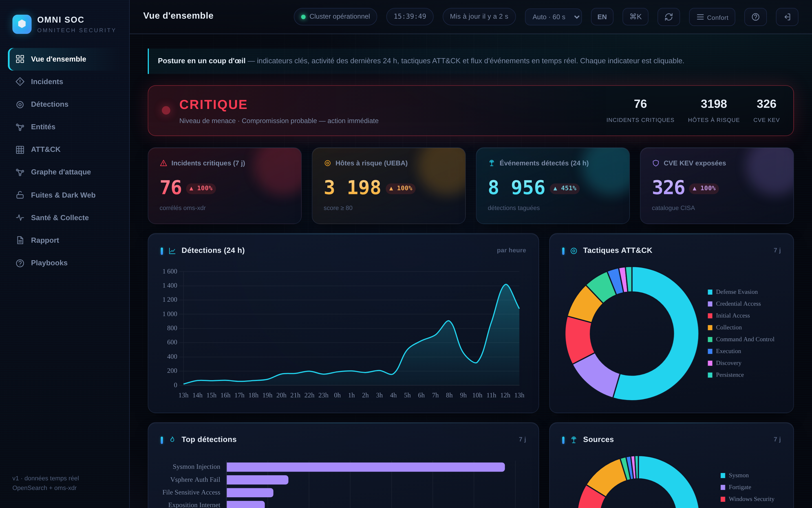

# OMNI SIEM — Plateforme de détection et de réponse

**SIEM, XDR et console SOC auto-hébergés, de niveau production, bâtis sur Graylog et entièrement provisionnés en code.**
*Self-hosted, production-grade SIEM, XDR and SOC console — built on Graylog, provisioned entirely as code.*

<br>


</div>

> **Dépôt opérationnel interne.** Ce dépôt provisionne le SIEM de **production** d'OMNITECH SECURITY : il doit être traité comme de l'infrastructure-as-code sensible. Aucun secret réel n'est versionné (voir [Sécurité et secrets](#sécurité-et-secrets)).

---

## Sommaire

- [Présentation et objectifs](#présentation-et-objectifs)
- [Overview (English)](#overview-english)
- [Aperçu visuel](#aperçu-visuel)
- [Le cycle d'une alerte](#le-cycle-dune-alerte)
- [Capacités clés](#capacités-clés)
- [Architecture](#architecture)
- [Prérequis](#prérequis)
- [Ordre d'installation](#ordre-dinstallation)
- [Configuration : 00-vars.env](#configuration--00-varsenv)
- [Enrôlement des hôtes (agents Windows, Linux, Aruba)](#enrôlement-des-hôtes-agents-windows-linux-aruba)
- [Intégration FortiGate / FortiAnalyzer multi-site](#intégration-fortigate--fortianalyzer-multi-site)
- [Gestion TLS et CA interne](#gestion-tls-et-ca-interne)
- [Organisation du dépôt](#organisation-du-dépôt)
- [Validation post-installation](#validation-post-installation)
- [Sauvegarde et restauration](#sauvegarde-et-restauration)
- [Dépannage](#dépannage)
- [Supervision du SIEM](#supervision-du-siem)
- [Limites connues](#limites-connues)
- [Sécurité et secrets](#sécurité-et-secrets)
- [Conformité ISO 27001:2022](#conformité-iso-270012022)
- [État et feuille de route](#état-et-feuille-de-route)
- [Stack et versions épinglées](#stack-et-versions-épinglées)
- [Documentation associée](#documentation-associée)
- [Licence](#licence)

---

## Présentation et objectifs

Plateforme **SIEM + XDR + console SOC** complète et reproductible, déployée sur une VM Debian durcie (`bx-it-graylog-vm`), avec un kit d'enrôlement Windows/AD et Linux. Elle collecte Windows Security/Sysmon, FortiGate/FortiAnalyzer (3 sites), Microsoft 365, vSphere, ESET, Vaultwarden, Veeam, DNS, Linux, Aruba et Entra ID ; normalise tout dans un **schéma commun** ; exécute **234 règles de pipeline** et **142 définitions d'alerte** mappées **MITRE ATT&CK** ; ajoute une **analyse comportementale (UEBA/NDR)**, un **scoring ML (`oms-ml`)**, une **corrélation d'incidents kill-chain (`oms-xdr`)**, un **triage d'alertes intelligent** (scoring multi-signaux + LLM local — mail réservé au critique, boucle de faux positifs), un **SOAR léger** (blocage FortiGate multi-site BDX/IV/LC), une **console SOC web + PWA mobile** bilingue et **115 playbooks d'action** — le tout provisionné par des scripts **idempotents** et documenté pour l'**audit ISO 27001:2022**.

Objectifs de conception :

- **Tout est code** : chaque script est rejouable sans danger (`set -euo pipefail`, contrôles finaux), le dépôt est la source de vérité du provisioning.
- **Précision avant volume** : tuning des faux positifs mesuré, triage systématique, le mail n'est envoyé que pour le critique.
- **Auditable** : rétentions par paliers, chaîne d'intégrité HMAC (`omni-integrity`), générateur de preuves daté, mapping ISO 27001:2022.

## Overview (English)

A complete, reproducible **SIEM + XDR + SOC console** deployed on a single hardened Debian VM, with a Windows/AD enrolment kit. It ingests Windows Security/Sysmon, FortiGate/FortiAnalyzer, Microsoft 365, vSphere, ESET, Vaultwarden and Veeam; normalises everything into a common schema; runs **234 pipeline rules** and **142 alert definitions** mapped to **MITRE ATT&CK**; adds behavioural analytics (UEBA/NDR), an ML scoring layer (`oms-ml`), kill-chain incident correlation (`oms-xdr`), an intelligent alert-triage layer (multi-signal scoring + local LLM — mail reserved for the critical few, false-positive feedback loop), light SOAR (multi-site FortiGate auto-block), a bilingual SOC web console + mobile PWA, and 115 action playbooks — all provisioned by idempotent scripts and documented for ISO 27001:2022 evidence. The rest of this document is in French; the SOC console itself is fully bilingual FR/EN.

## Aperçu visuel

> Captures **pseudonymisées** — comptes, hôtes, IP et SID sont anonymisés de façon cohérente (mode `MOBILE_REDACT`).

### Console SOC « OMNI SOC »

<div align="center">

| | |
|:---:|:---:|
| [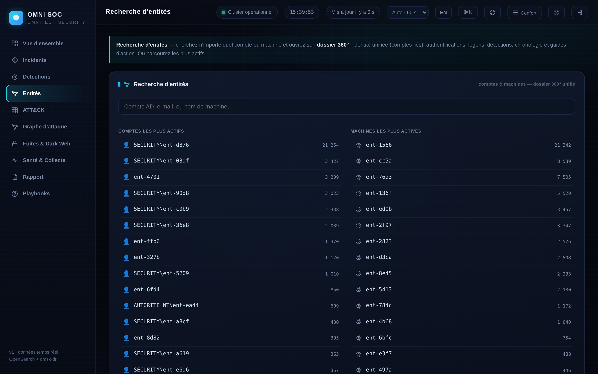](docs/captures/02-entites.png)<br>**Entités** — classées par risque fusionné + watchlist | [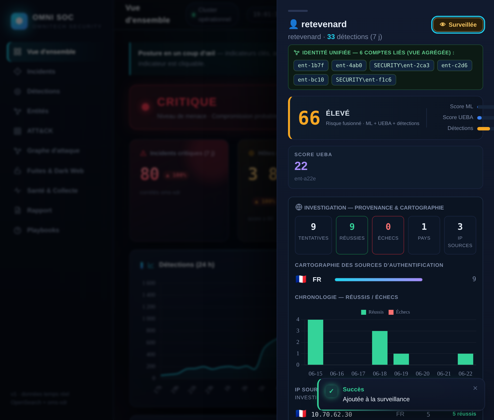](docs/captures/10-dossier360.png)<br>**Dossier 360** — jauge de risque fusionné, identité unifiée, provenance |
| [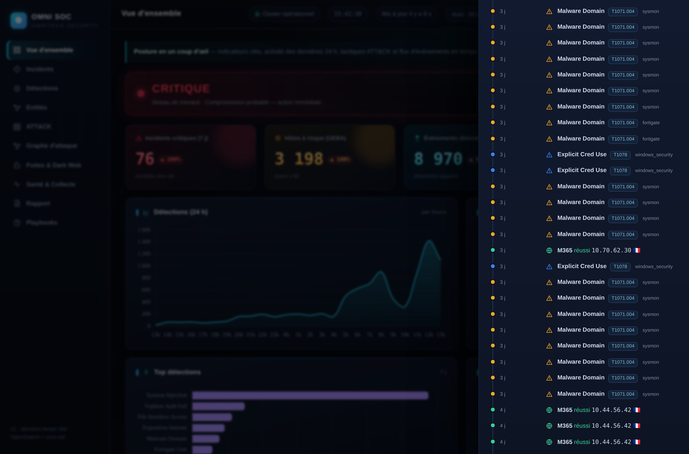](docs/captures/10b-timeline.png)<br>**Chronologie unifiée** — détections + authentifications, par date | [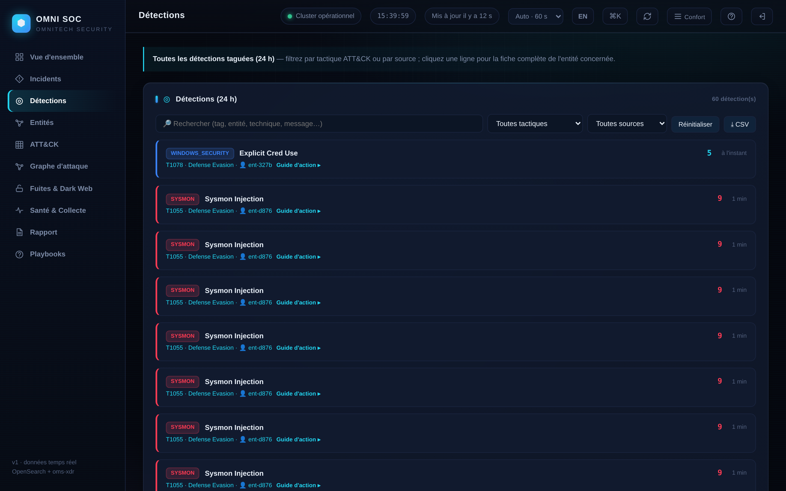](docs/captures/04-detections.png)<br>**Détections** — liste 24 h + guide d'action intégré |
| [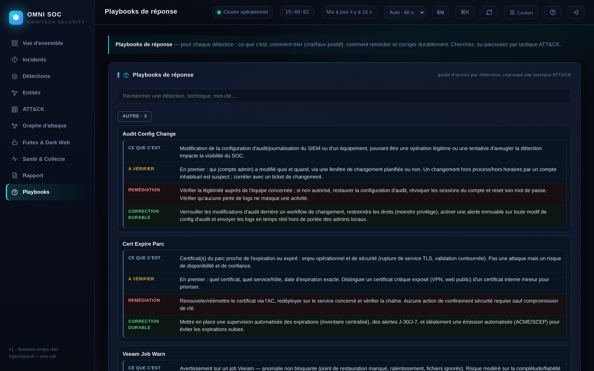](docs/captures/05-playbooks.png)<br>**Playbooks** — ce que c'est / vérifier / remédier / corriger | [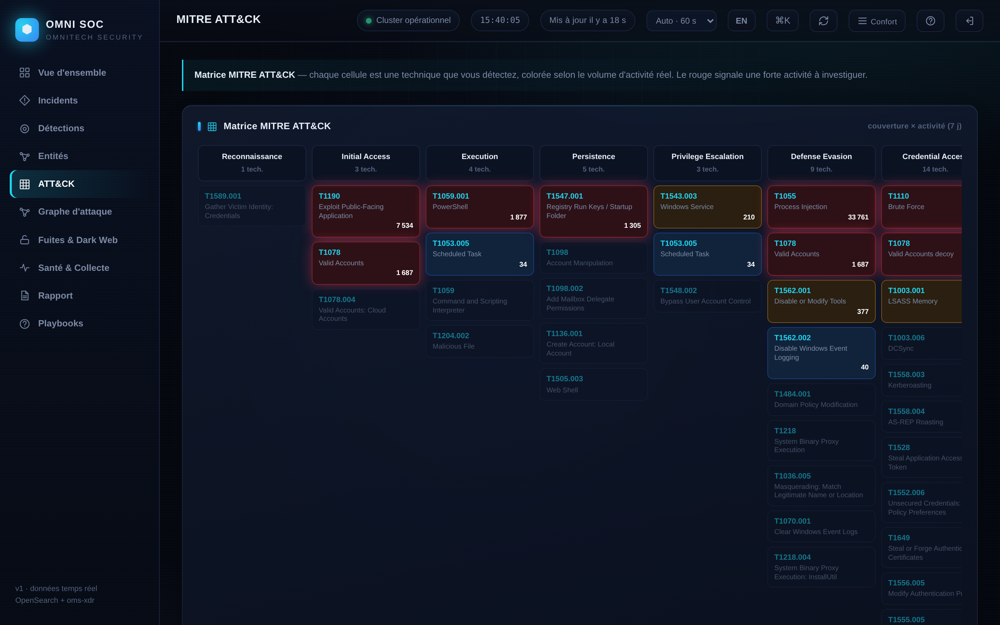](docs/captures/06-attack.png)<br>**Matrice MITRE ATT&CK** — couverture et activité |
| [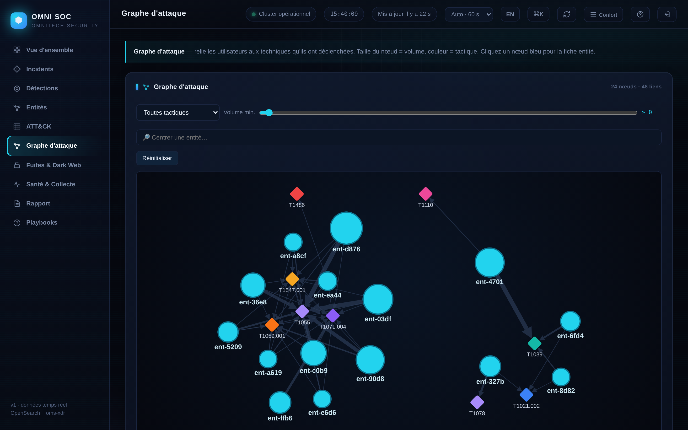](docs/captures/07-graphe.png)<br>**Graphe d'attaque** — entités et techniques | [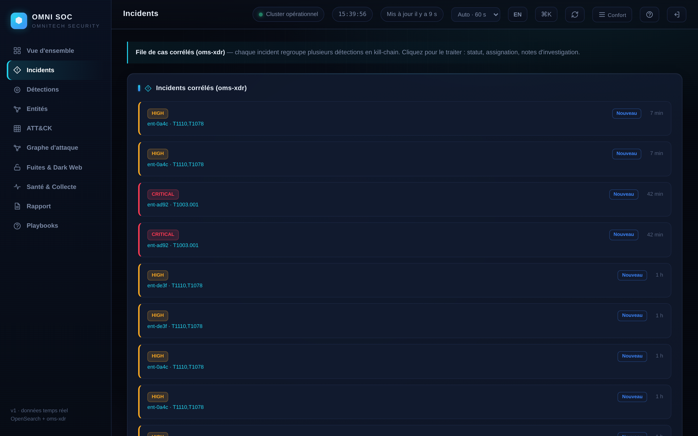](docs/captures/03-incidents.png)<br>**Incidents** — cas corrélés (oms-xdr) |
| [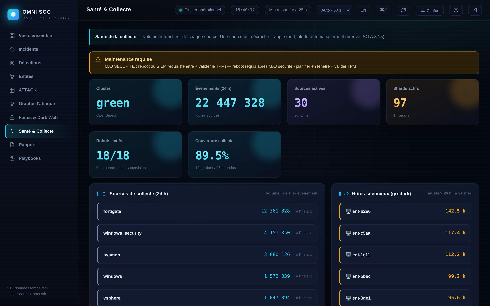](docs/captures/08-sante.png)<br>**Santé et collecte** — cluster, SLA, santé des robots | [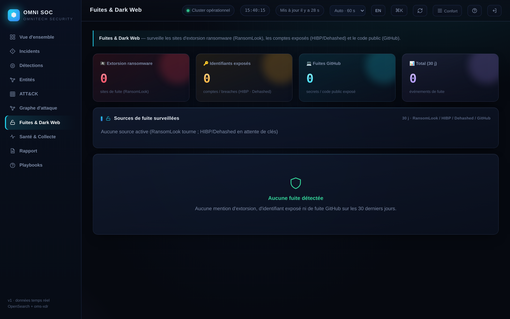](docs/captures/09-fuites.png)<br>**Fuites et Dark Web** — RansomLook / HIBP / Dehashed / GitHub |

[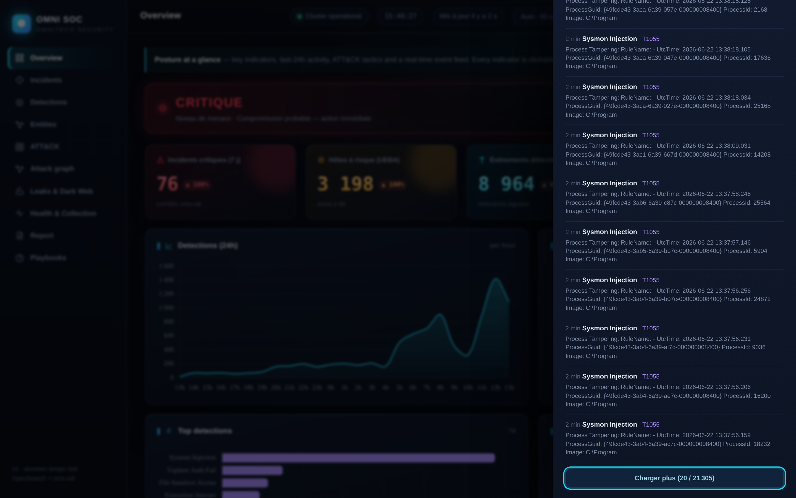](docs/captures/11-overview-en.png)

**Interface bilingue FR/EN** — bascule instantanée et persistée.

</div>

### PWA mobile — application installable, notifications web-push

<div align="center">

| | |
|:---:|:---:|
| [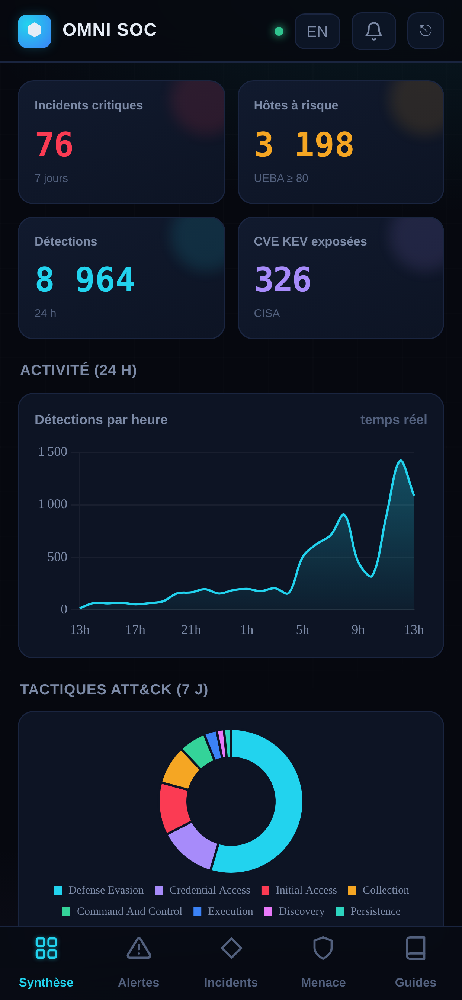](docs/captures/12-pwa-mobile.png)<br>**Menace** — parité console (ML / UEBA) | [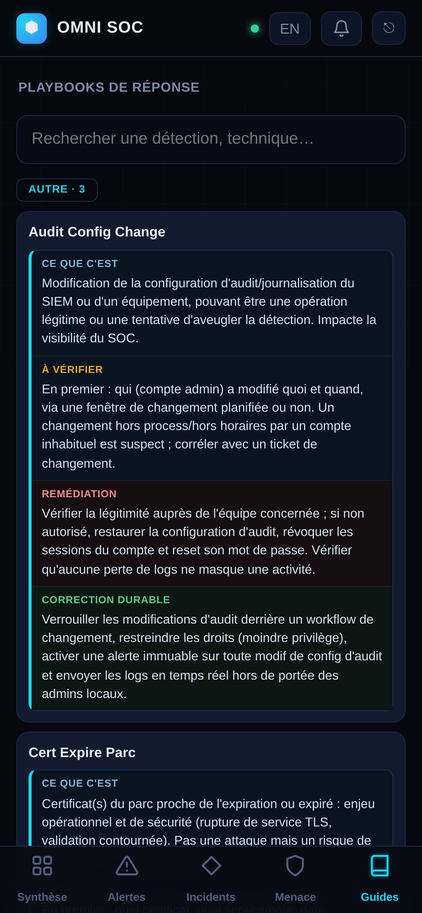](docs/captures/13-pwa-guides.png)<br>**Guides** — playbooks par tactique |

</div>

## Le cycle d'une alerte

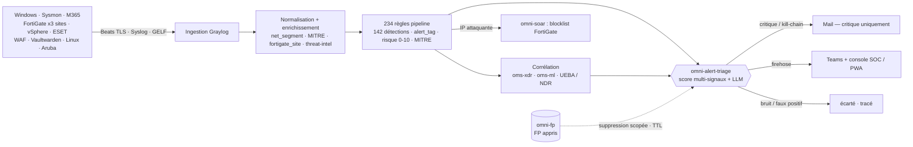

> **De la source au verdict.** Chaque log est normalisé, enrichi (MITRE, segment réseau, site FortiGate, threat-intel), confronté à **234 règles et 142 détections**, corrélé (XDR / ML / UEBA), puis **trié** : le **mail est réservé au critique**, tout le reste reste visible dans Teams et la console SOC. Un faux positif marqué (`omni-fp`) éteint le bruit futur — sans jamais masquer un critique.

## Capacités clés

| Capacité | Rôle |
|---|---|
| **Detection engineering** | **234 règles** de pipeline sur les streams sources (AD/Sysmon, FortiGate x3 sites, FortiManager, M365, vSphere...) : événements tagués (`alert_tag`) + **142 définitions d'alerte**, fenêtres glissantes |
| **Triage d'alertes intelligent** | `omni-alert-triage` : score multi-signaux (tier, priorité, actif critique, threat-intel, hors-heures, kill-chain) + jugement LLM de la zone grise ; mail réservé au critique, Teams en firehose, bruit écarté ; boucle de faux positifs (`omni-fp`, scopée + TTL, jamais sur un critique). Tout passe par le triage : zéro mail direct |
| **MITRE ATT&CK** | `alert_tag` vers techniques/tactiques, score de risque 0-10, couche ATT&CK Navigator + matrice de couverture interactive + backlog de couverture (analyse de lacunes, `DETECTION-BACKLOG.md`) |
| **Recherche d'entités et dossier 360** | Tout compte ou machine : identité unifiée, authentifications, logons, détections, chronologie, guides ; score de risque fusionné (ML + UEBA + sévérité), entités classées par risque, watchlist |
| **Console SOC visuelle** | 28 tableaux de bord natifs par domaine (identité, M365, réseau, Aruba/Linux/EMS, endpoint...) + carte mondiale 3D des flux temps réel + recherche plein-texte (palette Ctrl+K, pivot alerte vers logs bruts) |
| **Corrélation d'identité** | `SECURITY\rdupont`, `adm-rdupont`, `rdupont@dom` reconnus comme une seule personne (comptes liés agrégés) ; machines jamais fusionnées |
| **Chronologie unifiée** | Le récit d'une entité : détections + échecs d'authentification Windows + sign-ins M365 fusionnés et triés par date, sur tous les comptes liés |
| **XDR et LLM local** | `oms-xdr` : corrélation kill-chain multi-sources, scoring d'incident, triage/narration par LLM local (Ollama, CPU), réponse en dry-run (double verrou) |
| **UEBA / NDR** | Z-score de volume, voyage impossible (Haversine), beaconing C2 (CV des intervalles), tunnel DNS (entropie), scan interne, score de risque d'entité 0-100 |
| **ML (`oms-ml`)** | Anomalie non supervisée (IsolationForest) en direct + réduction de faux positifs supervisée (features contextuelles par entité) |
| **Playbooks et alertes auto-explicatives** | 115 playbooks (ce que c'est / vérifier / remédier / corriger) ; chaque alerte porte cause décodée, EventID, ATT&CK et risque ; guide d'action intégré à chaque détection |
| **Threat intel et fuites** | abuse.ch (C2 Feodo, domaines URLhaus, filtre qualité : infrastructure partagée écartée), CISA KEV + ancienneté de patch ; RansomLook, HIBP, Dehashed, GitHub |
| **SOAR et réponse** | Blocage automatique des IP attaquantes sur FortiGate multi-site (feeders WAF / spray / brute VPN ; sans identifiant, TTL, liste blanche, audit) ; désactivation de compte AD via LDAPS (dry-run + denylist + audit + validation humaine) |
| **Précision (environ 0 % FP visé)** | Tuning FP mesuré et vérifié adversarialement (allowlists ancrées sur les chemins, garde-fous anti-faux-négatif) ; auto-supervision des **37 robots** ; chaîne d'intégrité HMAC |
| **Conformité et intégrité** | Rétention par paliers, chaîne anti-altération (`omni-integrity`), registre d'amélioration continue (clause 10) + générateur de preuves daté, mapping ISO 27001:2022 |

## Architecture

Tout tient sur une seule VM Debian 13 durcie, données au repos chiffrées (`/data` en LUKS2/TPM2) :

```
 Postes / Serveurs ───Winlogbeat TLS 5044──┐      GPO OMNI-AUDIT-Baseline (DC)
 (Sysmon + audit GPO)                       │      + distribution NETLOGON\SIEM (NinjaOne)
                                            ▼
 FortiGate x3 ─► FortiAnalyzer ──syslog/CEF 1514/5555──► ┌─────────────────────────────────┐
                                                         │  bx-it-graylog-vm (Debian 13)   │
 Microsoft 365 ──Graph API (pull)────────────────────────│  Nginx TLS :443                 │
 vSphere ──────syslog 1516───────────────────────────────│   ├─ Graylog 7.1 :9000 (TLS)    │
 ESET PROTECT ─syslog 1515───────────────────────────────│   ├─ OpenSearch 2.19 :9200      │
 Linux ────────syslog 1519 · Aruba syslog 1520───────────│   │    (données sur /data LUKS2)│
 Vaultwarden / Veeam ──Filebeat / canal──────────────────│   ├─ MongoDB 8.0 rs0            │
 Cert Orchestrator ──GELF UDP 12201──────────────────────│   └─ Console SOC + PWA (:8090,  │
 Admins / SOC ─────HTTPS 443─────────────────────────────│      loopback, derrière nginx)  │
                                                         └─────────────────────────────────┘
        │                                                          │ GELF :12201
        │   37 microservices Python (/usr/local/sbin/omni-*)       │ (event_source=siem_*)
        └──  UEBA · NDR · oms-ml · oms-xdr · SOAR · triage · rapports ─┘
```

Composants sur la VM :

- **Graylog 7.1** (ingestion, streams, pipelines, alertes) — API en TLS sur `:9000`, derrière nginx.
- **OpenSearch 2.19** (indexation) et **MongoDB 8.0** (configuration Graylog), liés à `127.0.0.1` uniquement ; données OpenSearch sur `/data` chiffré LUKS2.
- **Nginx** : terminaison TLS `:443` (console Graylog, console SOC `/soc/`, PWA `/m/`, kit d'enrôlement `/kit/`).
- **37 microservices Python** (`/usr/local/sbin/omni-*`) + moteurs `oms-xdr`, `oms-ml`, `oms-graph` : UEBA, NDR, SOAR, triage, threat-intel, rapports, supervision — pilotés par des timers systemd.
- **Console SOC + PWA** : backend `mobile/omni-mobile-api.py` (stdlib), écoute loopback `:8090`, proxifié par nginx.

## Prérequis

Contrôlés automatiquement par `./00-preflight.sh` (rapport PASS/WARN/FAIL) :

- **OS** : Debian 13, accès root, dépôts apt joignables.
- **CPU** : jeu d'instructions **AVX** obligatoire (MongoDB 8 ; sur Proxmox, type de CPU `host`).
- **RAM** : 30 Go minimum validés par le preflight (heaps OpenSearch/Graylog dimensionnés dans `00-vars.env`).
- **Disques** : un disque data dédié pour `/data` (chiffré LUKS2/TPM2 par le provisioning), détecté et proposé par le preflight.
- **Réseau** : FQDN résolu, ports d'inputs libres (443, 5044, 1514-1520, 12201...), flux ouverts depuis les sources (voir `06-firewall.sh`).

`./00-preflight.sh --gen-vars` génère `00-vars.env.autodetect` avec les suggestions à reporter dans `00-vars.env`.

## Ordre d'installation

Le socle s'installe strictement dans l'ordre numérique ; au-delà, les scripts sont regroupés par fonction et rejouables individuellement (idempotents).

```bash
cd omnitech-siem-setup && chmod +x *.sh
cp 00-vars.env.example 00-vars.env && chmod 600 00-vars.env && $EDITOR 00-vars.env  # secrets CHANGEME

./00-preflight.sh --gen-vars   # analyse l'hôte : AVX, RAM, disques, réseau, dépôts, ports
./01-base.sh ./02-mongodb.sh ./03-opensearch.sh ./04-graylog.sh ./05-nginx-tls.sh
./06-firewall.sh ./07-inputs.sh ./08-backup.sh ./09-snmpd.sh
./10-graylog-model.sh ./11-graylog-enrichment.sh ./12-graylog-pipelines.sh
./13-graylog-alerts.sh ./14-graylog-dashboards.sh
```

Puis les groupes fonctionnels, dans cet ordre (chaque script documente ses prérequis en tête de fichier) :

| # | Groupe | Scripts | Contenu |
|---|---|---|---|
| 1 | Socle et certificats | `00`-`09`, `98` | OS de base, MongoDB, OpenSearch, Graylog, nginx/TLS, pare-feu nftables, inputs, sauvegarde, SNMP, templates d'index |
| 2 | Inputs et parsing | `07`, `10`-`12`, `16`-`19` | Inputs, modèle de données/index sets, enrichissement (lookups), **pipelines** ; M365 (`16`-`18`), vSphere (`19`) |
| 3 | Streams et alertes | `13`, `21`, `22` | **Définitions d'alerte**, hygiène (grace/backlog), routage 2-tiers |
| 4 | Dashboards | `14`, `82`, `84-dashboards-triage-site` | Tableaux de bord natifs, analytics, triage et multi-site (ce dernier en fin de séquence, voir tableau des doublons) |
| 5 | Détections | `37`, `47`, `57`, `67`, `73`, `76`, `78`, `80`, `84-kerberoast-dedup`, `85-detection-extra3`, `85-detections-backlog`, `87`, `88`, `89` | MITRE, détections par familles, tuning FP, déception/honeytokens, graphe d'attaque, backlog de couverture |
| 6 | UEBA / NDR | `40-ueba-ndr`, `43`, `48-ndr-scan`, `49-ldap-recon` | Scoring comportemental, tunnel DNS, beaconing, scan interne, reconnaissance LDAP |
| 7 | Enrichissement | `11`, `49-enrich-lots`, `49-expo-port-class`, `50`, `51`, `97-enrich-alerts` | Lookups, segments réseau, classification d'exposition, threat-intel, enrichissement du contenu des alertes |
| 8 | SOAR, triage, XDR, ML | `36`, `38-alert-triage`, `69`, `77`, `97-multisite-soar` + `oms-xdr/`, `oms-ml/`, `triage/` | Blocage FortiGate, triage mail, réponse AD (dry-run), corrélation, ML |
| 9 | Supervision | `32`, `39`, `46`, `60`, `61`, `74`, `86` (+`09`, `62`) | SLA de collecte, self-health des robots, watchdog de sources, intégrité, versioning des services |
| 10 | Rétention et purge | `31`, `41`, `53`, `54`, `79`, `83` (+`40-purge-logs`, manuel) | Rétentions différenciées, purge et repopulation |
| 11 | Rapports et ISO | `15`, `34`, `45`, `68` (+`33`, `35`, `58`, `59`, `64`) | Rapports hebdo/mensuel, preuves ISO, LDAPS, canary, corrélation d'identité, audit fichiers |
| 12 | Sources spéciales | `52`, `55`, `56`, `63`, `90`, `91`, `92`, `93`, `94`, `99-cert-orchestrator` | Vaultwarden, FortiDHCP, FortiManager, FortiClient EMS, DNS, Linux, Aruba, Entra ID, orchestrateur de certificats |
| 13 | Fuites et dark web | `70`, `72` | GitHub, RansomLook, HIBP, Dehashed |
| 14 | Console et kit | `65`, `71`, `75`, `81`, `95`, `96` | PWA mobile, console SOC, durcissement console, allowlists FP, publication du kit `/kit/`, corrélation cross-source |

### Numéros dupliqués : ordre correct d'exécution

Sept numéros sont **partagés par plusieurs scripts** (38, 40, 48, 49, 84, 85, 97) : se fier au **nom complet** du script et à son en-tête, jamais au seul numéro. Ordre correct :

| Numéro | Scripts | Ordre et conditions |
|---|---|---|
| 38 | `38-vuln-scan.sh` · `38-alert-triage.sh` | `38-vuln-scan` avec les détections (requiert l'inventaire `Get-OmniInventory.ps1`) ; `38-alert-triage` **après** `13` et `21` (il s'insère entre les alertes et le mail) |
| 40 | `40-ueba-ndr.sh` · `40-purge-logs.sh` | `40-ueba-ndr` dans la séquence UEBA/NDR ; `40-purge-logs` est **manuel uniquement** (efface le contenu des index), jamais dans un rejeu automatique |
| 48 | `48-m365-fail-codes.sh` · `48-ndr-scan.sh` | `48-m365-fail-codes` après `16`-`18` (M365) puis relancer `14` ; `48-ndr-scan` après `21` et `37`, puis relancer `13` et `14` |
| 49 | `49-enrich-lots.sh` · `49-expo-port-class.sh` · `49-ldap-recon.sh` | Les deux enrichissements d'abord (prérequis `12` + `37`, relancer `13` et `14` ensuite), `49-ldap-recon` après (requiert le collecteur en place et `37`) |
| 84 | `84-kerberoast-dedup.sh` · `84-dashboards-triage-site.sh` | `84-kerberoast-dedup` avec les détections ; `84-dashboards-triage-site` en **fin de séquence** (consomme `event_source:alert_triage` et `fortigate_site`, donc après `38-alert-triage` et `97-multisite-soar`) |
| 85 | `85-detection-extra3.sh` · `85-detections-backlog.sh` | `85-detection-extra3` puis `85-detections-backlog` (tous deux après `13`, `21`, `37`) |
| 97 | `97-multisite-soar.sh` · `97-enrich-alerts.sh` | `97-multisite-soar` d'abord (requiert `36` et le pipeline FortiGate de `12`) ; `97-enrich-alerts` en **dernier** (passe générique sur toutes les définitions d'alerte existantes) |

Autres points d'attention :

- Les dépendances sont indiquées en tête de chaque script (exemple : `39-collect-health.sh` requiert 21 et 12, et relance 13 et 14). Relancer `21-alert-hygiene.sh` après tout re-run de `13-graylog-alerts.sh`.
- La numérotation comporte des trous (20, 23-29) : ils sont normaux, aucun script ne manque.

> **Variante conteneurisée (DR / staging / démo)** — toute la plateforme (Graylog + OpenSearch + MongoDB + console + nginx TLS + oms-xdr) en `docker compose`, secrets durcis et restauration de la configuration complète depuis une sauvegarde : voir `docker/README-DOCKER.md`. La production reste le déploiement bare-metal chiffré LUKS.

## Configuration : 00-vars.env

Toute la configuration passe par un fichier unique, jamais versionné :

```bash
cp 00-vars.env.example 00-vars.env
chmod 600 00-vars.env
$EDITOR 00-vars.env    # remplacer chaque CHANGEME
```

- `00-vars.env.example` est le **gabarit commenté** : identité machine, réseau, disques, heaps, ports, intégrations. Les valeurs `CHANGEME` sont des secrets à définir localement.
- Les lignes marquées `A VERIFIER` doivent être contrôlées avant tout lancement.
- Placer les commentaires **sur des lignes séparées** : certains collecteurs Python relisent ce fichier (`load_env`) et ne strippent pas les commentaires en fin de ligne.
- Les secrets annexes (comptes de service, webhooks, clés API) sont recensés dans `SECRETS.example.md` (gabarit ; le fichier réel `SECRETS.md` est ignoré par git).

Tous les scripts sourcent ce fichier en premier, puis `lib-graylog.sh` (voir [Dépannage](#dépannage) : l'ordre est impératif).

## Enrôlement des hôtes (agents Windows, Linux, Aruba)

Tout hôte s'enrôle en **une commande**, depuis la page **Déploiement** de la console SOC (one-liner à copier, téléchargements, état « déjà vu »). Les installeurs vérifient les prérequis et convergent (idempotents, relançables). Artefacts servis sous `/kit/` (TLS), publiés par `95-kit-deploy.sh` (génère `SHA256SUMS`).

| OS | One-liner | Téléchargement | Transport |
|---|---|---|---|
| **Windows** | `irm https://<siem>/kit/install.ps1 \| iex` | `install.ps1` + conf | Winlogbeat **TLS 5044** |
| **Linux** Debian/Ubuntu | `curl -fsSL https://<siem>/kit/install.sh \| sudo bash -s -- 10.33.220.10` | `install.sh` | Syslog **TCP 1519** |
| **Linux** RHEL/Rocky/SUSE | idem (détection `dnf`/`yum`/`zypper`) | `install.sh` | Syslog **TCP 1519** |
| **Switch Aruba** AOS-S | `logging 10.33.220.10` (sur le switch) | — | Syslog **UDP/TCP 1520** |

- **Windows** (`install.ps1`) : prérequis (admin, PowerShell 5.1+, 64 bits, TCP 5044 + 443), auto-élévation UAC, puis délégation au coeur idempotent `Install-OmniSiem-NinjaOne.ps1` (CA TOFU, audit, Sysmon, Winlogbeat, santé, inventaire). Détail complet : `windows/README-WINDOWS.md` (GPO `OMNI-AUDIT-Baseline`, distribution NETLOGON/NinjaOne).
- **Linux** (`install.sh`) : prérequis + paquets (`rsyslog`/`auditd`/`logger`) multi-distribution, forward auth/sudo/sshd/auditd vers SIEM:1519, règles auditd `omni_*`, test d'émission, résumé `[OK]/[KO]`.
- **Intégrité (TOFU)** : le premier appel HTTPS récupère `omnitech-rootca.pem` (le CA n'est pas encore épinglé), qui est ensuite installé (`LocalMachine\Root` sous Windows) et utilisé par Beats — après quoi toute la chaîne est validée. Fenêtre MITM au premier contact uniquement, sur réseau interne. Vérification : `curl https://<siem>/kit/SHA256SUMS` (comparé automatiquement par `install.ps1`).

## Intégration FortiGate / FortiAnalyzer multi-site

- Les **3 FortiGate** (sites BDX / IV / LC) journalisent vers le **FortiAnalyzer**, qui forwarde en syslog/CEF vers les inputs 1514/5555 du SIEM. Configuration côté Fortinet : dossier `fortigate/` (logging UTM, forwarding FAZ, durcissement VPN, policies UTM par site) et guide `FORTIANALYZER.md`.
- Le pipeline enrichit chaque événement d'un champ **`fortigate_site`** (lookup `lookups/fortigate-sites.csv`) : dashboards, détections et triage sont déclinés par site.
- Le **SOAR** (`36-soar.sh`, `97-multisite-soar.sh`) publie une **blocklist threat-feed** consommée par les FortiGate des trois sites (feeders WAF / password spray / brute-force VPN ; sans identifiant sur les firewalls, TTL, liste blanche, audit).
- Sources Fortinet complémentaires : FortiManager (`63`), FortiClient EMS en syslog TLS (`90`), FortiGate DHCP (`56`).

## Gestion TLS et CA interne

- **CA racine interne OMNITECH** (`omnitech-rootca`) : toute la chaîne HTTPS du SIEM est émise par la PKI interne. `05-nginx-tls.sh` installe la terminaison TLS nginx ; l'API Graylog elle-même est en TLS (`https://<fqdn>:9000/api`), validée avec `/etc/graylog/certs/omnitech-rootca.crt` (voir `lib-graylog.sh`).
- **Distribution du CA aux hôtes** : mécanisme TOFU du kit d'enrôlement (section précédente) — le CA est récupéré au premier contact puis épinglé (magasin Windows, configuration Beats).
- **Transports chiffrés** : Winlogbeat en Beats TLS 5044, FortiClient EMS en syslog-TLS, console et kit en HTTPS 443.
- **Surveillance des expirations** : le parc Windows remonte l'état de ses certificats via le canal `OMNI-Certificats` (tag `cert_parc`, règle pipeline dédiée du script 12) et l'orchestrateur de certificats (BX-IT-CERT-VM) émet en GELF UDP 12201 (`99-cert-orchestrator.sh` : input, règle pare-feu, stream, pipeline, alerte d'erreur).

## Organisation du dépôt

| Chemin | Contenu |
|---|---|
| `00`-`09*.sh` | OS de base, MongoDB, OpenSearch, Graylog, nginx/TLS, pare-feu, inputs, sauvegarde, SNMP |
| `10`-`14*.sh` | Modèle de données, enrichissement, **pipelines**, alertes, tableaux de bord |
| `15`-`22*.sh` | Rapports, M365, vSphere, hygiène et routage des alertes |
| `30`-`99*.sh` | Résilience, rétention/ISO, LDAPS, **SOAR**, **MITRE**, **UEBA/NDR**, scan vuln, corrélation, intégrité, **triage d'alertes (38)**, dashboards (84), **backlog de détections (85)**, **multi-site FortiGate (97)**, orchestrateur de certificats (99), allowlists FP |
| `oms-ml/` · `oms-xdr/` · `oms-graph/` | Couche ML (anomalie + réduction FP) · moteur de corrélation XDR · graphe |
| `triage/` · `tools/` | Service de **triage d'alertes** (`omni-alert-triage` : scoring multi-signaux + LLM + boucle FP `/fp`) · outils CLI (`omni-fp`...) |
| `mobile/` | Backend console SOC + **PWA** (`omni-mobile-api.py`, stdlib), fronts `soc/` et `www/` |
| `docker/` | **Déploiement conteneurisé** (DR/staging) : stack 6 services + secrets durcis + restore (`docker/README-DOCKER.md`) |
| `kit/` | Installeurs d'enrôlement (`install.ps1`, `install.sh`) publiés sous `/kit/` par `95-kit-deploy.sh` |
| `lib-graylog.sh` | Helpers API Graylog (TLS, `api_get`/`api_post`, `ensure_rule`/`ensure_pipeline`/`ensure_lookup`, `wrap_entity`...) |
| `windows/` · `fortigate/` | GPO d'audit AD + kit agent · durcissement UTM/VPN FortiGate |
| `lookups/` | Tables CSV (EventID, MITRE, segments réseau, sites FortiGate, `alert-guidance.json`...) |
| `tests/` · `run-tests.sh` | Suite de tests hors ligne (py_compile + pytest : backend mobile, oms-ml, oms-xdr) |
| `docs/` | Corpus ISO 27001 (politique, standards, procédures, PRA, registres), architecture, guide de dépannage, captures — index : `docs/00-INDEX.md` |
| `00-vars.env.example` · `SECRETS.example.md` | **Gabarits** de configuration et de secrets (valeurs réelles jamais versionnées) |

## Validation post-installation

Vérifications concrètes, dans l'ordre, une fois le provisioning terminé :

```bash
cd /root/omnitech-siem-setup

# 1. Contrôle global lecture seule : noyau, /data déchiffré, services coeur,
#    API Graylog, robots, collecte vivante -> PASS/FAIL par contrôle
./verif-post-reboot.sh

# 2. Santé du cluster d'indexation (attendu : "green")
curl -s http://127.0.0.1:9200/_cluster/health | jq -r .status

# 3. API Graylog joignable et inputs en RUNNING
source ./00-vars.env && source ./lib-graylog.sh    # ordre impératif
api_get '/system/cluster/nodes' | jq '.nodes[].is_leader'
api_get '/system/inputstates'   | jq -r '.states[] | "\(.state)\t\(.message_input.title)"'

# 4. Robots et timers actifs (triage, XDR, UEBA, sauvegardes, supervision)
systemctl list-timers 'omni-*' 'oms-*' --all
journalctl -u omni-self-health -n 20 --no-pager   # attendu : "N/N robots OK"

# 5. Dépôt de snapshots OpenSearch enregistré (attendu : un objet, pas une 404)
curl -s http://127.0.0.1:9200/_snapshot/graylog_fs | jq .

# 6. Suite de tests hors ligne (aucun service requis)
./run-tests.sh
```

Compléments : la page **Santé et collecte** de la console `/soc/` (cluster, SLA de collecte par hôte, santé des robots) et le tableau de bord Graylog correspondant donnent la même information en continu.

## Sauvegarde et restauration

Deux mécanismes complémentaires, installés par le provisioning :

- **`08-backup.sh`** — sauvegardes applicatives quotidiennes (timer `siem-backup`, 02:30) : `mongodump` (toute la configuration Graylog) vers `/home/siem-backup/mongo`, **snapshot OpenSearch** (dépôt `graylog_fs`, incrémental, données indexées) et tar des configurations (`/etc/graylog`, opensearch, mongod, nginx, nftables), avec rétention locale.
- **`30-backup-config.sh`** — sauvegarde **config** complète (timer `omni-backup-config`, 03:15) : dump MongoDB + configurations + collecteurs `omni-*` + unités systemd + kit + le dépôt IaC lui-même (arbre de travail complet, fichiers non commités inclus), dans une **archive chiffrée AES-256**, vérifiée (test de restaurabilité à chaque run) puis exportée vers le partage SMB `${SMB_BACKUP_UNC}` avec rétention `${BACKUP_RETENTION_J}` jours et **alerte GELF en cas d'échec ou d'absence** (alertes provisionnées par le script 21). Cette archive n'inclut **pas** les indices OpenSearch (logs).

Points d'attention sur les snapshots OpenSearch :

- L'enregistrement du dépôt `graylog_fs` vit dans le **cluster state** OpenSearch : toute recréation de celui-ci (migration de `path.data`, wipe) **perd l'enregistrement** alors que `path.repo` et les fichiers du dépôt restent en place. C'est arrivé en production lors de la migration vers `/data` : les snapshots ont cessé sans alerte. Remède : rejouer l'étape d'enregistrement de `08-backup.sh` (le `PUT _snapshot/graylog_fs`).
- L'échec du snapshot dans `siem-backup.sh` est **silencieux** (le `curl` avale la 404) : intégrer le contrôle n° 5 de la [validation post-installation](#validation-post-installation) à toute intervention sur OpenSearch, et surveiller `/var/log/siem-backup.log`.

Procédures de restauration :

- **`RESTORE.md`** — restauration complète pas à pas depuis l'archive chiffrée (VM de remplacement, même IP/FQDN, redémarrage de la collecte).
- **`docs/PRA-RECONSTRUCTION-SIEM.md`** — plan de reconstruction (objectifs de continuité, scénarios, rôles, validation), référence ISO A.8.13 / A.5.30.
- **`docker/README-DOCKER.md`** — restauration de la configuration dans la stack conteneurisée (DR/staging).

La VM est par ailleurs sauvegardée entière par Veeam ; les dumps applicatifs garantissent en plus une restauration cohérente et granulaire. Une restauration MongoDB seule (corruption de la configuration) a déjà été validée en production depuis `/home/siem-backup/mongo`.

## Dépannage

Guide complet symptôme / cause / solution : **`docs/GUIDE-DEPANNAGE.md`**. Référence exhaustive des incidents résolus : `CONTEXT.md` (sections « PIEGE A RETENIR »). Pièges récurrents à connaître avant d'intervenir :

| Piège | Règle |
|---|---|
| **Ordre de sourcing** | Toujours `source ./00-vars.env` **puis** `source ./lib-graylog.sh` (dans le dépôt, en root). `lib-graylog.sh` construit la variable `API` à partir de `SIEM_FQDN` : dans l'autre ordre, `API` est vide et tous les appels échouent silencieusement |
| **Enveloppe `wrap_entity` (API 7.x)** | Les POST de création d'entités partageables (streams, event definitions, notifications, dashboards) exigent l'enveloppe `CreateEntityRequest` (`{entity: ..., share_request: ...}`). Passer par les helpers de `lib-graylog.sh` (`wrap_entity`, `ensure_*`), jamais par un POST brut au schéma 6.x |
| **Codes retour trompeurs de l'API** | `api_put`/`api_post` peuvent renvoyer exit 0 alors que l'API a rejeté l'objet : toujours vérifier la présence de `.id` dans la réponse |
| **Commentaires de règles pipeline** | Le langage des règles pipeline n'accepte que les commentaires `//` ; ne jamais utiliser `#` dans le source d'une règle (rejet au parsing, parfois silencieux selon le chemin d'appel) |
| **Pas de ternaire en règle pipeline** | L'opérateur ternaire `cond ? a : b` n'existe pas dans le langage des pipelines Graylog : utiliser des règles ou des blocs conditionnels séparés (voir `99-cert-orchestrator.sh`) |
| **Renommage par titre = doublons** | Les helpers `ensure_*` retrouvent les entités **par titre** : changer un titre dans un script ne renomme pas l'objet existant, il en **crée un second**. Pour renommer, mettre à jour l'objet par son id (PUT) ou supprimer l'ancien titre explicitement |
| **Cache des lookups** | Après modification d'un CSV de `lookups/`, purger le cache : `POST /system/lookup/tables/<table>/purge` (voir les exemples dans `93-aruba.sh` et `97-multisite-soar.sh`), sinon les anciennes valeurs sont servies |
| **`ensure_lookup` canonique** | Utiliser la version unique de `lib-graylog.sh` (adapter + cache + table) ; les copies locales historiques provoquaient des lookups jamais créés, en échec silencieux |
| **Stages de pipeline** | Un stage `match either` avec une règle conditionnelle peut bloquer la suite : garder la normalisation dans le stage 0 (convention du dépôt : stage 0 = normalisation, 5 = lookups, 10 = détections) |
| **Re-run des alertes** | Relancer `21-alert-hygiene.sh` après chaque re-run de `13-graylog-alerts.sh` (qui recrée grace/clés par défaut) |
| **Commentaires dans `00-vars.env`** | Sur des lignes séparées uniquement : les collecteurs Python (`load_env`) ne strippent pas les commentaires en ligne |
| **Dépôt de snapshots perdu** | Après migration de `path.data` ou wipe : ré-enregistrer `graylog_fs` (voir [Sauvegarde et restauration](#sauvegarde-et-restauration)) |

## Supervision du SIEM

Le SIEM se surveille lui-même ; tout remonte en GELF (`event_source=siem_*`) dans le stream interne, avec alertes dédiées :

- **`46-self-health.sh` / `61-supervision-robots.sh`** — `omni-self-health` (timer 30 min) : le filet « qui surveille les surveillants », contrôle l'exécution de chaque robot (`event_source=siem_health`).
- **`39-collect-health.sh`** — `omni-collect-health` (timer horaire) : couverture SLA du parc (baseline 30 jours, silence par hôte, go-dark).
- **`74-source-watchdog.sh`** — détection de **source silencieuse** (agent mort, flux coupé, journal désactivé par un attaquant) : fraîcheur par `event_source` avec seuils par source. Limite à connaître : deux flux distincts partageant le même `event_source` se masquent mutuellement (le canal encore vivant maintient la source « verte »).
- **Sauvegardes surveillées** — alertes « Backup config SIEM en échec » / « absent > 26 h » (scripts 30 + 21) ; les snapshots OpenSearch ne sont en revanche pas couverts par cette alerte (voir [Sauvegarde et restauration](#sauvegarde-et-restauration)).
- **`09-snmpd.sh`** — exposition SNMP pour la supervision d'infrastructure existante.
- **Console** — page Santé et collecte de `/soc/` (cluster, SLA, robots) et tableaux de bord Graylog associés.

## Limites connues

- **Mono-nœud = SPOF** : Graylog, OpenSearch et MongoDB tournent sur une seule VM, sans haute disponibilité. La reprise repose sur les sauvegardes (archive chiffrée, snapshots, Veeam) et le PRA (`docs/PRA-RECONSTRUCTION-SIEM.md`), pas sur un basculement automatique.
- **Réponse AD non armée** : la désactivation de compte via LDAPS reste en dry-run (double verrou), en attente d'accès API / délégation AD.
- **OpenSearch 3.x incompatible** avec Graylog 7.1 : rester en 2.19.x (paquets tenus en hold, voir [Stack et versions épinglées](#stack-et-versions-épinglées)).
- **Fenêtre TOFU** : le CA interne n'est épinglé qu'après le premier contact HTTPS du kit d'enrôlement (fenêtre MITM au premier appel uniquement, réseau interne).
- **Les logs ne sont pas dans la sauvegarde config** : l'archive chiffrée quotidienne couvre la configuration complète, pas les indices OpenSearch ; la profondeur d'historique repose sur les snapshots OpenSearch (`08-backup.sh`, à re-vérifier après toute intervention sur le cluster) et la sauvegarde VM Veeam. Après une restauration config seule, l'historique repart de zéro (voir `RESTORE.md`).
- **Numérotation des scripts** : plusieurs numéros sont partagés (38, 40, 48, 49, 84, 85, 97) — se référer au [tableau des doublons](#numéros-dupliqués--ordre-correct-dexécution) et à l'en-tête de chaque script.

## Sécurité et secrets

- **Aucun secret n'est versionné.** `.gitignore` exclut `00-vars.env`, `SECRETS.md`, tous les `*.key`/`*.pem`/`*.cred`/certificats. Utiliser les gabarits `*.example`.
- Secrets de service dans `00-vars.env` (`chmod 600`) ; clés TLS, keyfile Mongo, `password_secret` Graylog sous `/etc` et `/root` avec permissions strictes.
- Services internes liés à `127.0.0.1` uniquement (OpenSearch, MongoDB, API Graylog, backend console) ; seuls nginx (443) et les inputs sont exposés, derrière nftables + FortiGate.
- **`/data` chiffré au repos** (LUKS2/TPM2) ; captures de démonstration **pseudonymisées** (`MOBILE_REDACT`).
- Login de la console mobile protégé par un rate-limit applicatif (verrouillage par IP après échecs répétés) ; fail2ban sur SSH.

## Conformité ISO 27001:2022

Preuves Annexe A produites par la plateforme : **A.8.15/8.16** (journalisation et surveillance), **A.8.8** (vulnérabilités), **A.5.7** (renseignement sur les menaces), **A.8.11** (masquage), **A.5.25/5.26** (réponse à incident), **A.8.13** (sauvegarde), **A.5.37 / A.8.32** (procédures et gestion du changement — ce dépôt), **Clause 10** (amélioration continue).

- **Rétentions différenciées par paliers (90 / 180 / 365 jours)** provisionnées en code (`41-retention-iso.sh`, `83-retention-consolidee.sh`) et adaptées à la valeur probante de chaque source ; politique de référence : `docs/POLITIQUE-RETENTION.md`.
- **Mapping et preuves** : mapping complet des mesures dans `docs/ISO27001-MAPPING.md` (synthèse à la racine : `ISO27001.md`), générateur de preuves daté (`68-iso-evidence.sh`) et corpus de preuves dans `docs/ISO27001-preuves.md` ; registres, procédures et audits indexés par `docs/00-INDEX.md`.
- **Intégrité** : chaîne anti-altération HMAC (`omni-integrity`), sauvegardes chiffrées exportées hors de l'hôte.

## État et feuille de route

**Production.**

**Livré** : corrélation XDR + triage LLM local (`oms-xdr`), triage de mail intelligent (`omni-alert-triage` — scoring multi-signaux + LLM de la zone grise + boucle de faux positifs `omni-fp`, avec bouton « FP » par alerte dans la console `/soc/`), scoring ML (`oms-ml`), FortiGate multi-site (BDX/IV/LC, enrichissement par site + feeder SOAR WAF), console SOC + PWA bilingues (recherche d'entités, dossier 360, chronologie unifiée, corrélation d'identité, 115 playbooks intégrés, scores ML/UEBA, graphe d'attaque, SLA collecte et santé des robots), threat-intel filtrée en qualité + surveillance des fuites, matrice ATT&CK + backlog de couverture (`DETECTION-BACKLOG.md`), actionneur AD (dry-run), registre clause 10.

**À venir** : isolation d'endpoint ESET + armement de la réponse AD (en attente d'accès API / délégation), couche LLM cloud optionnelle (conseil) avec tokenisation déterministe.

## Stack et versions épinglées

Debian 13 · Graylog 7.1 · OpenSearch 2.19.x (3.x casse Graylog) · MongoDB 8.0 · Winlogbeat OSS 8.x. Montées de version contrôlées uniquement : `apt-mark unhold`, vérification de la matrice de compatibilité Graylog, upgrade, puis re-hold.

## Documentation associée

| Document | Contenu |
|---|---|
| `GUIDE.md` | Présentation vulgarisée de la plateforme (lecteur non technique) |
| `CONTEXT.md` | Référence technique exhaustive : historique, décisions, pièges rencontrés |
| `docs/00-INDEX.md` | Index du corpus documentaire ISO (politique, standards, procédures, registres, audits) |
| `docs/DOSSIER-ARCHITECTURE-SIEM.md` | Dossier d'architecture |
| `docs/GUIDE-DEPANNAGE.md` | Dépannage symptôme / cause / solution |
| `RESTORE.md` · `docs/PRA-RECONSTRUCTION-SIEM.md` | Restauration pas à pas · plan de reconstruction (PRA) |
| `FORTIANALYZER.md` · `M365.md` · `VSPHERE.md` · `VEEAM.md` | Guides d'intégration par source |
| `ISO27001.md` · `docs/ISO27001-MAPPING.md` · `docs/ISO27001-preuves.md` | Synthèse, mapping et preuves ISO 27001:2022 |
| `docs/POLITIQUE-RETENTION.md` | Politique de rétention des journaux |
| `DETECTION-BACKLOG.md` | Backlog de couverture MITRE ATT&CK (analyse de lacunes) |
| `windows/README-WINDOWS.md` · `docker/README-DOCKER.md` | Volet Windows/AD · déploiement conteneurisé |

## Licence

Le dépôt est publié sous licence **GNU GPLv3** (fichier `LICENSE`). Il reste un **dépôt opérationnel interne** OMNITECH SECURITY : la licence couvre le code de provisioning ; les configurations, adresses et conventions propres à l'environnement OMNITECH ne sont pas destinées à être réutilisées telles quelles.

---

<div align="center">
<sub>OMNITECH SECURITY — plateforme SIEM / XDR interne · provisionnée par scripts idempotents · secrets exclus par conception.</sub>
</div>

> English version: [README.md](README.md). Documents are kept in French (`*.md`) with English translations (`*.en.md`).
