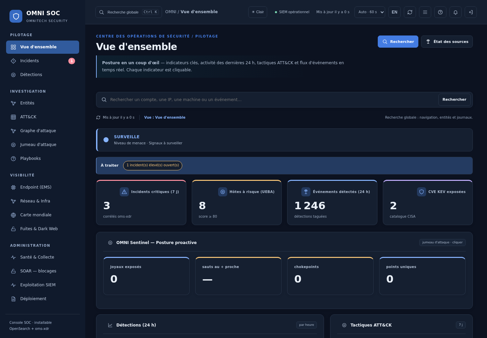
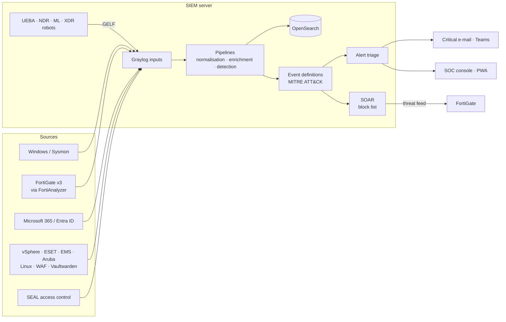

<div align="center">



<small>Current SOC console, shown with synthetic demonstration data.</small>

# OMNI SIEM

**A self-hosted SIEM and SOC console built on Graylog, OpenSearch and
MongoDB, used for detection and incident response at OMNITECH SECURITY.**


[Version française](README.fr.md) · [Documentation (French)](docs/README.md) · [Roadmap](docs/ROADMAP.md) · [Changelog](CHANGELOG.md)

</div>

> **Internal infrastructure repository.** This repository provisions and
> maintains OMNITECH SECURITY's production SIEM. Treat it as sensitive
> infrastructure code: no secret is ever committed (see [SECURITY.md](SECURITY.md)).
> French is the reference language of the project; this README and a few
> overview documents are maintained in English.

## Overview

OMNI SIEM collects logs from the whole information system (Windows
workstations and servers, Fortinet firewalls on three sites, Microsoft 365
and Entra ID, virtualisation, antivirus, WAF, Linux, switches, physical
access control), normalises them into a common field schema, runs
detections mapped to MITRE ATT&CK, and adds in-house services:

- **alert triage**: multi-criteria scoring, grouping, and a call to an
  external LLM API for ambiguous cases only (layer out of service on
  2026-11-21, see limitations); only critical alerts are e-mailed;
- **incident correlation** (`oms-xdr`), **anomaly detection** (`oms-ml`) and
  an **exposure graph** (`oms-graph`);
- **bounded, reversible automated response**: IP blocking on the FortiGate
  firewalls through a threat feed, with expiry, exclusions and a simulation mode;
- a **SOC web console** and an installable app (PWA), with
  [site-configured pages and widgets](docs/CONSOLE-MODULES.md) for existing Graylog streams;
- **ISO/IEC 27001:2022 evidence**: tiered retention, integrity chain, monthly
  evidence packs.

## Capabilities in service

Read-only snapshot of the reference installation taken on 2026-11-21
(Graylog API, systemd). These figures describe that installation; a fresh
installation only deploys the core platform.

| Item | Value |
|---|---|
| Graylog inputs | 14 |
| Streams | 21 |
| Pipelines / pipeline rules | 40 / 277 |
| Detection and correlation definitions | 210, 199 enabled (excluding Graylog's system definition) |
| Graylog dashboards | 13 |
| Lookup tables | 34 |
| systemd timers for the analysis robots (`omni-*`, `oms-*`) | 51 |
| Distinct ATT&CK techniques in the mapping table | 77, across 12 tactics |
| Per-alert decision guides | 150 (`lookups/alert-guidance.json`) |

Sources with a dedicated input or stream: Windows Security, Sysmon and other
Windows logs (Winlogbeat over TLS), FortiGate on three sites through
FortiAnalyzer, FortiManager, FortiClient EMS, FortiGate DHCP, Microsoft 365
and Entra ID, vSphere, ESET PROTECT, BunkerWeb, Vaultwarden, Linux, Aruba
switches, SEAL physical access control (access, alarms, audit).

The number of definitions measures catalogue breadth, not detection
effectiveness. [Automated detection checks and synthetic fixtures](docs/detection/VALIDATION-DETECTIONS.md)
are available; their results do not replace a controlled campaign on the target
environment (see [Status and limitations](#status-and-limitations)).

## Architecture

Everything runs on **a single physical server** (Debian 13; the host name
`bx-it-graylog-vm` is historical), with OpenSearch data encrypted at rest
(LUKS2, TPM2 unlock). Internal services listen on loopback; only nginx
(HTTPS) and the collection inputs are exposed, filtered by nftables.



English overview documents: [architecture](docs/architecture/ARCHITECTURE.md),
[data sources](docs/DATA-SOURCES.md), [detection engine](docs/detection/DETECTIONS.md),
[alerting and triage](docs/ALERTING-AND-TRIAGE.md),
[operations and resilience](docs/OPERATIONS.md), [deployment](docs/DEPLOYMENT.md),
[SOC console guide](docs/CONSOLE-SOC.en.md). Screenshots: [visual overview](docs/demarrage/APERCU-VISUEL.md) (French captions).

## Requirements

- Ubuntu Server 24.04 or 22.04, or Debian 12 or 13, amd64, with systemd;
  Ubuntu 26.04 is experimental (see the [qualification report](docs/QUALIFICATION-UBUNTU2604.md), in French).
- CPU with AVX, at least 16 GB of RAM, storage sized for the log volume.
- Root access, correct DNS name and FQDN, access to the vendor repositories.

Disk encryption (LUKS/TPM) on the reference installation is a separate
operation; the installer does not create it. Details:
[INSTALLATION.md](docs/INSTALLATION.md) (French).

## Quick start

Fresh machine (read-only plan first, then apply):

```bash
git clone https://github.com/jmorin-info/omnitech-siem-setup.git
cd omnitech-siem-setup
cp 00-vars.env.example 00-vars.env && chmod 600 00-vars.env
$EDITOR 00-vars.env                      # fill in the site settings
sudo bash install.sh --generate-secrets
sudo bash install.sh --plan
sudo bash install.sh --apply
```

The installed profile includes MongoDB, OpenSearch, Graylog, base inputs and
pipelines, initial detections, the SOC dashboard, nginx, the `/soc/` console
and a daily backup. Extensions (robots, XDR/ML, SOAR, connectors that need
credentials) are enabled afterwards, each through its own procedure.

A terminal administration interface wraps these operations:
`sudo python3 tools/omni-manager.py`. For an existing instance, follow the
[code update procedure](docs/UPDATES.md) (French).

**Never run the numbered scripts in a loop**: some purge logs or change
retention. Their role and status are listed in
[SCRIPTS-PROVISIONING.md](docs/reference/SCRIPTS-PROVISIONING.md) (French).

## Repository layout

| Path | Content |
|---|---|
| `NN-*.sh` | Numbered provisioning scripts ([inventory](docs/reference/SCRIPTS-PROVISIONING.md)) |
| `install.sh`, `tools/` | Installer, SSH manager, updater, tools; `tools/ponctuel/`: dated one-off scripts |
| `lib-graylog.sh`, `lib-platform.sh` | Shared helpers (Graylog API, platform detection) |
| `triage/`, `soar-v2/` | Alert triage, SOAR |
| `oms-xdr/`, `oms-ml/`, `oms-graph/` | Correlation, ML, exposure graph (tested Python projects) |
| `mobile/` | SOC console, PWA and backend |
| `seal/` | SEAL physical access control integration |
| `integrations/`, `omni_integrations/` | WatchGuard, UniFi, Palo Alto modules |
| `windows/`, `kit/`, `fortigate/` | Windows agents and GPOs, enrolment kit, Fortinet configuration |
| `lookups/` | Lookup tables and decision guides |
| `deploye/` | Mirror of the code in service, synchronised through a manifest |
| `docker/` | Containerised staging or disaster-recovery stack |
| `docs/` | Documentation ([index](docs/README.md)) |
| `tests/`, `run-tests.sh` | Offline tests and documentation link check |

## Status and limitations

The platform is in production at OMNITECH SECURITY. Known limitations, tracked
in the [roadmap](docs/ROADMAP.md):

- **Single-server architecture**: Graylog, OpenSearch, MongoDB and the in-house
  services share one server, without high availability. Recovery relies on
  backups and the rebuild plan, not on failover.
- **Detection validation still to be demonstrated**: offline tests cover the
  code and rules were replayed against history, but no automated attack
  scenario campaign measures the detection rate yet.
- **LLM triage**: the LLM layer is out of service on 2026-11-21 (API calls
  rejected); ambiguous cases then fall back to rule-based grouping. Its false
  negatives and robustness against hostile log content are not measured yet. The LLM layer only decides whether an e-mail is sent;
  it never triggers a blocking action.
- **Recovery not timed**: backup restorability is tested automatically, but a
  full rebuild on a blank machine with a measured RTO has not been carried out.
- **Partial history in backups**: the daily archive covers configuration;
  logs are only covered by selective snapshots (recent windows of large indices).
- **Account and endpoint response not armed**: AD account disabling and
  endpoint isolation remain recommendations (simulation).
- **Organisational debt**: 102 numbered scripts (four retired ones archived under `tools/ponctuel/`), nine of them sharing a
  prefix, a few obsolete scripts, and several services still running from an
  older copy of the repository on the server.

## Contributing, security, license

- Development conventions: [CONTRIBUTING.md](CONTRIBUTING.md) (French).
- Vulnerability reporting and secrets handling: [SECURITY.md](SECURITY.md) (French).
- License: **GNU GPLv3** ([LICENSE](LICENSE)). The repository is specific to
  the OMNITECH environment: addresses, names and conventions are not meant to
  be reused as is.
